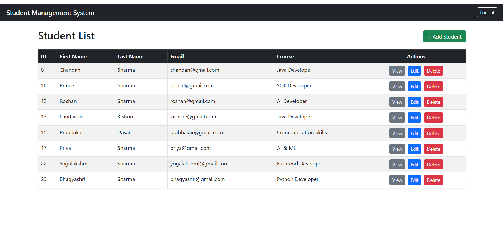
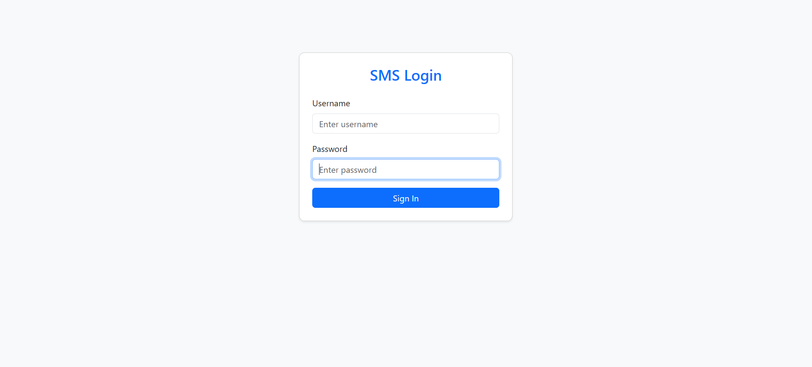
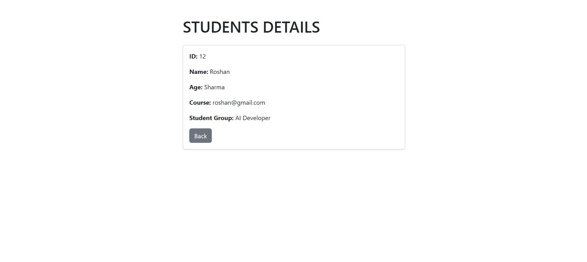
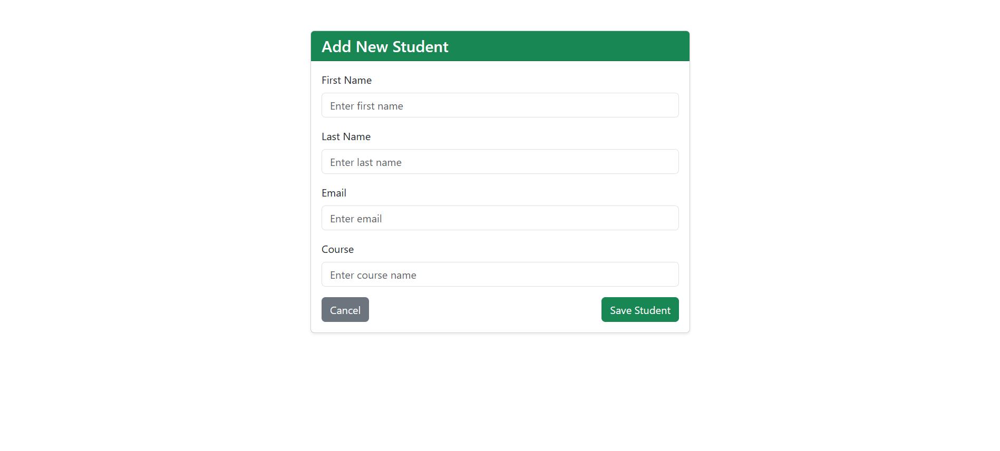
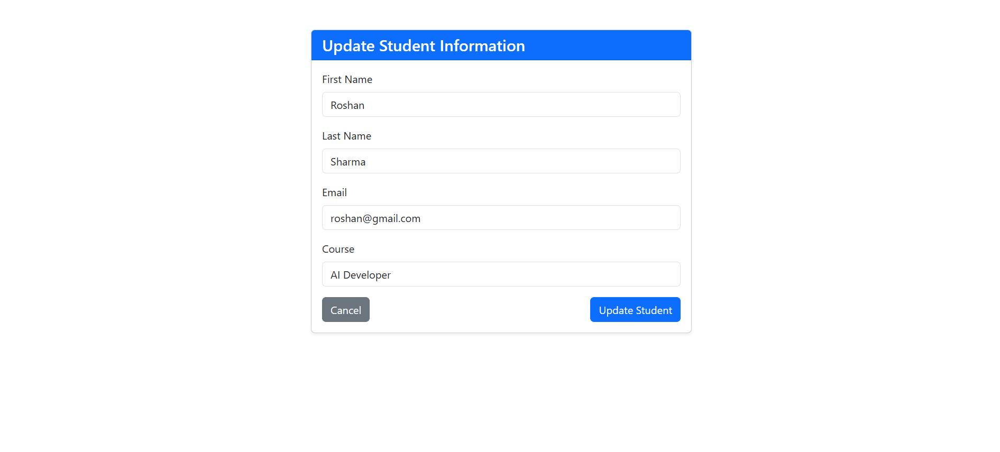

# Student Management System

A web-based Student Management System developed using Java, Spring Boot, Spring Security, Thymeleaf, Spring Data JPA, and MySQL. The application provides a user-friendly interface for managing student records with authentication and database integration.

## 📌 Project Overview

The Student Management System simplifies student record management by providing operations to add, view, update, and delete student information. It follows a layered backend architecture and uses MySQL for persistent data storage.

## ✨ Features

- 🔐 Login and authentication with Spring Security
- ➕ Add new student records
- 📋 View all student records
- ✏️ Update student information
- 🗑️ Delete student records
- 🗄️ MySQL database integration
- 🔄 Database operations using Spring Data JPA and Hibernate
- 🌐 Server-side rendering using Thymeleaf
- 🧩 Organized Spring Boot application structure

## 🛠️ Tech Stack

| Technology | Purpose |
|---|---|
| Java | Application development |
| Spring Boot | Backend framework |
| Spring Security | Authentication and access control |
| Spring Data JPA | Database operations |
| Hibernate | Object-relational mapping |
| MySQL | Relational database |
| Thymeleaf | Dynamic HTML pages |
| HTML and CSS | User interface |
| Maven | Build and dependency management |
| Eclipse IDE | Development environment |
| Git and GitHub | Version control and hosting |

## 📸 Application Screenshots

### 1. Home Page



### 2. Login Page



### 3. View Students



### 4. Add Student



### 5. Update Student



**Screenshot troubleshooting:** Keep the images inside the `screenshots` folder at the same level as this `README.md` file. The image names and extensions in these links must match the real files, including capitalization. If your files use `.jpg`, `.jpeg`, or `.PNG`, update the corresponding links.

## 📂 Project Structure

```text
student-management-system/
├── src/
│   ├── main/
│   │   ├── java/
│   │   │   └── [application packages]
│   │   └── resources/
│   │       ├── static/
│   │       ├── templates/
│   │       └── application.properties
│   └── test/
├── screenshots/
│   ├── home.png
│   ├── login.png
│   ├── view.png
│   ├── addstudent.png
│   └── update.png
├── .gitignore
├── mvnw
├── mvnw.cmd
├── pom.xml
└── README.md
```

*This is a representative structure. Your actual Java package names and resource files may differ.*

## ⚙️ Prerequisites

Before running the project, install:

- Java JDK compatible with the project
- MySQL Server
- Eclipse IDE or another Java IDE
- Git (optional, for version control)

Maven can be used directly or through the Maven Wrapper included in the project.

## 🚀 Getting Started

### 1. Clone the Repository

```bash
git clone https://github.com/roshansharma3105rk/student-management-system.git
cd student-management-system
```

### 2. Create the Database

Open MySQL and execute:

```sql
CREATE DATABASE student_db;
```

### 3. Configure Database Credentials

Configure your local database connection using environment variables:

```text
DB_URL=jdbc:mysql://localhost:3307/student_db?useSSL=false&serverTimezone=UTC&allowPublicKeyRetrieval=true
DB_USERNAME=your_mysql_username
DB_PASSWORD=your_mysql_password
```

Replace the example credentials with your own local MySQL credentials. Never publish your real database password.

Your `application.properties` can use the following configuration:

```properties
server.port=8080

spring.datasource.url=${DB_URL:jdbc:mysql://localhost:3307/student_db?useSSL=false&serverTimezone=UTC&allowPublicKeyRetrieval=true}
spring.datasource.username=${DB_USERNAME}
spring.datasource.password=${DB_PASSWORD}
spring.datasource.driver-class-name=com.mysql.cj.jdbc.Driver

spring.jpa.hibernate.ddl-auto=update
spring.jpa.show-sql=true
spring.jpa.properties.hibernate.dialect=org.hibernate.dialect.MySQLDialect

spring.thymeleaf.cache=false
spring.devtools.restart.enabled=true
spring.devtools.livereload.enabled=true
```

**Note:** The example uses MySQL port `3307`. Change it if your MySQL server uses another port. Set the required environment variables in your Eclipse Run Configuration or your operating system before starting the application.

### 4. Run the Application

Open the project in Eclipse and run the main Spring Boot application class.

Alternatively, from the project directory:

**Windows**

```bash
mvnw.cmd spring-boot:run
```

**Linux/macOS**

```bash
./mvnw spring-boot:run
```

Make sure MySQL is running and your database environment variables are configured.

### 5. Open the Application

After the application starts, open your browser:

- Application: http://localhost:8080
- Student list: http://localhost:8080/students
- Login: http://localhost:8080/login

The exact landing page and login route depend on your Spring Security configuration. Use the credentials configured for your application.

## 🧪 Testing

Manually verify the following workflows:

- Login and authentication
- Adding a student
- Viewing student records
- Updating student information
- Deleting student records
- Confirming that records persist in MySQL

Run automated tests, if configured, with:

```bash
mvn test
```

## 🔒 Security Best Practices

- Never commit passwords, API keys, or other sensitive credentials.
- Use environment variables for local database configuration.
- Keep local configuration files and secrets out of version control.
- Review Spring Security authorization rules before deployment.
- For production deployments, use managed secrets and an appropriate database migration strategy.

## 🔮 Future Enhancements

- Student search and filtering
- Pagination and sorting
- Improved form validation and error handling
- Role-based access control
- Unit and integration tests
- REST API support
- Cloud deployment

## 👨‍💻 Author

**Roshan Kumar Sharma**

- **GitHub:** [roshansharma3105rk](https://github.com/roshansharma3105rk)
- **LinkedIn:** [Connect with me on LinkedIn](https://www.linkedin.com/in/roshan-kumar-sharma-06072003rks/)

## 📄 License

This project is intended for learning and portfolio purposes. No specific open-source license is declared. Add a license file if you choose to distribute the project under formal license terms.